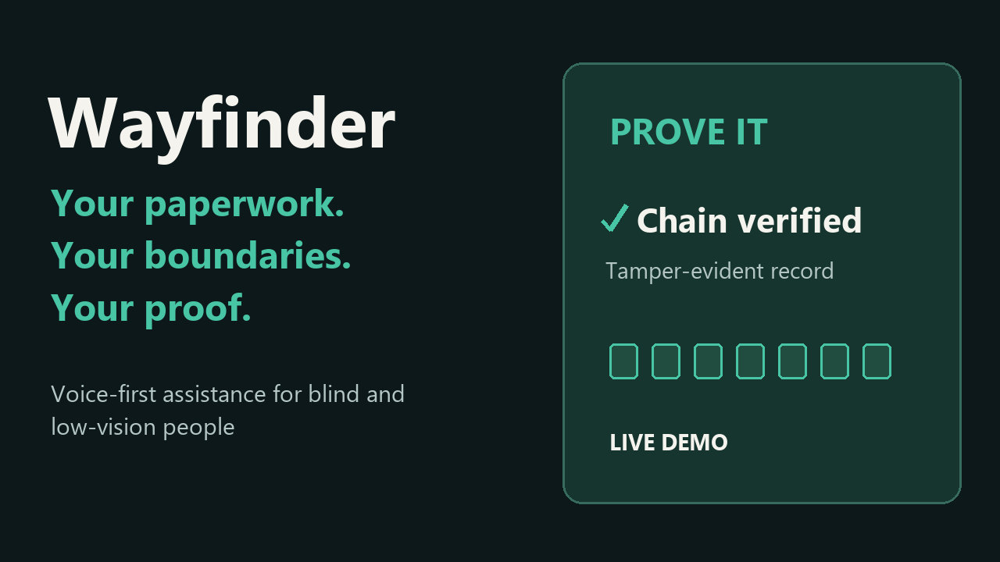

# Wayfinder

**Verifiable agency for the paperwork you can't glance at.**

[](LICENSE)
[](package.json)
[](#development)
[](tsconfig.json)
[](https://modelcontextprotocol.io)

Wayfinder is a voice-first **MCP server** that remembers the documents a blind or low-vision person cannot glance at, correlates them into threads, tracks what is still owed and at risk, acts only within limits the user sets, and keeps a tamper-evident record it can use to **prove what it did**.

It renders interactive **MCP App** screens into an MCP Apps host. The bundled web client demonstrates an Alexa+-style voice-and-screen experience. The core workflows run offline with a deterministic rule-based brain; reading new images requires a configured vision service.

**Submitted to Build, Ship, Shape: Amazon Developer Hackathon — Alexa+ track.**

[](docs/video/Wayfinder-submission.mp4)

**[Watch or download the 2:43 demo](docs/video/Wayfinder-submission.mp4)** · **[Screenshots](docs/gallery/README.md)** · **[Judge walkthrough](#judge-walkthrough)** · **[Submission details](docs/submission.md)**

The video shows the running MCP host with fictional sample documents, offline rules, and vision off. English narration and captions are included.

<!-- TOC -->
- [Why](#why)
- [What it does](#what-it-does)
- [Who it is for](#who-it-is-for)
- [Quick start](#quick-start)
- [Judge walkthrough](#judge-walkthrough)
- [Choosing a model](#choosing-a-model)
- [Using it](#using-it)
- [MCP surface](#mcp-surface)
- [The record](#the-record)
- [Accessibility](#accessibility)
- [Safety and privacy](#safety-and-privacy)
- [Optional integrations](#optional-integrations)
- [Project layout](#project-layout)
- [Development](#development)
- [Documentation](#documentation)
- [Alexa skill](#alexa-skill)
- [Submission artifacts](#submission-artifacts)
- [License](#license)

## Why

Sighted people verify state by looking. A blind person cannot, and is disproportionately targeted by fraud and routinely disbelieved when they assert what a document said. Access to information is not the hard problem — **auditable, bounded, accountable agency** is.

Perception (reading a letter, a bill, a label) is an *input*. The product is the durable, verifiable handler for the paperwork a person cannot glance at. Three ideas carry it:

- **Calibrated abstention** — it refuses to act on a document it is not confident it read, rather than guessing on a payment amount or an account number.
- **A bounded envelope** — every action is checked against limits the user sets, before anything changes.
- **A verifiable ledger** — every decision gets a receipt, in an append-only, hash-chained log the user can export and verify.

## What it does

- **Captures** a photo or upload and reads it into a structured document (sender, amount, due date, reference, account tail).
- **Correlates** documents into threads: reminders raise urgency, a correction supersedes the older letter, and duplicates collapse into one demand.
- **Ranks what matters** by deadline risk and reminder count, not a bare list.
- **Acts within your limits** — remind, schedule, flag, file, discard, or share with a trusted contact — asking first above the amount you set, and refusing what you forbade.
- **Records everything** in a hash-chained ledger, and proves the record has not been altered.
- **Hands off payments safely** — it prepares a spoken instruction and a scannable SEPA QR code for you to complete **in your own banking app**. It never moves money.
- **Speaks and shows**: results are voiced, and matched by accessible interactive cards on screen (backlog, audit history, verification badge, refusal card).

### How a request flows


## Who it is for

- **Blind and low-vision users** who want their post, bills, and letters handled with proof of what happened.
- **Caregivers and trusted contacts** who step in when something is unresolved.
- **Tinkerers and operators** who want to point the core at their own notification channel, calendar folder, or payment handoff.

## Quick start

**Prerequisites:** Node.js 22 or newer. No AWS account is required to run.

```bash
git clone https://github.com/C6Sucrose/Wayfinder.git
cd Wayfinder
npm ci
npm run build      # bundles the MCP App view, then compiles TypeScript
npm start          # MCP server on http://127.0.0.1:8080
```

In a second terminal, run the demo client (it proxies `/api` and `/mcp` to the server):

```bash
npm run dev:web    # open http://127.0.0.1:5173
```

Try these utterances in the client:

- "Read my mail."
- "What's due today?"
- "Where are my keys?" (say "Remember my keys are on the kitchen counter." first)
- Open **Backlog** for related documents ranked by urgency. In the offline rule mode, unmatched requests such as "What do I need to deal with?" return the daily briefing.
- "Prove it." — runs `verify_ledger` and reports the terminal hash

The [2:43 demonstration](docs/video/README.md) shows the offline workflow with fictional sample documents.

## Judge walkthrough

No login, API key, AWS account, or Alexa hardware is needed for the offline demo. Use a fresh checkout and seed the fictional documents **before starting the server**:

```bash
npm run seed:demo
npm run demo:preflight
npm start
```

The seed command resets the selected data directory; use it for sample data, not an existing personal inbox. `WARN server not reachable` during preflight is expected before `npm start`.

Run `npm run dev:web` in a second terminal and open **http://127.0.0.1:5173**:

1. Ask **"What's due today?"** for a briefing.
2. Open **Backlog** and expand the City Water thread: three reminders, one demand.
3. Open **Documents** and inspect the low-confidence insurance letter.
4. Choose **discard** on the Pizza Corner document and confirm. The authority envelope refuses the forbidden action and offers trusted-contact help.
5. Ask **"Prove it"** to verify the ledger, including the refusal.
6. Ask **"Where are my keys?"** to retrieve the seeded kitchen-counter location.
7. Try **Larger text**, the dark host theme, **Motion** off, and keyboard navigation.

`npm run demo:smoke` checks the local server, agent, ledger response, object memory, and Alexa response shapes. **"Read my mail" requires vision configuration**; the offline demo reports that the reader is unavailable rather than simulating extraction.

### Configuration

| Variable | Default | Purpose |
|---|---|---|
| `PORT` | `8080` | Server port |
| `WAYFINDER_DATA_DIR` | `data` | Where items, objects, preferences, and the ledger are stored |
| `WAYFINDER_CAPTURE_ROOT` | `WAYFINDER_DATA_DIR` | Root the image reader is allowed to read from |
| `ALLOWED_ORIGINS` | *(empty)* | Comma-separated origins accepted for `/mcp` and `/api/agent` |
| `BEDROCK_MODEL_ID` | *(unset)* | Enables the Amazon Bedrock brain and image reader |
| `AWS_REGION` | `us-east-1` | Region for Textract and Bedrock |

By default, with no chat provider and no `BEDROCK_MODEL_ID` configured, the server uses a deterministic **rule brain** that routes each utterance to one tool call, and the reader reports itself unavailable. Everything else — correlation, authority, the ledger, and every screen — works offline.

## Choosing a model

Bring your own model. One port, many providers; `rules` is the default and needs no key.

The provider presets describe three wire protocols: `openai-compatible`, `anthropic-messages`, and `bedrock-converse`. This release wires the OpenAI-compatible chat adapter and a separate legacy Bedrock path; native Anthropic and Bedrock chat adapters are not implemented. A `rules` run needs no key.

| Provider id | Protocol | Default model | Key env | Images |
|---|---|---|---|---|
| `rules` | — | — | — | No |
| `openai` | `openai-compatible` | `gpt-4o-mini` | `OPENAI_API_KEY` | Yes |
| `azure` | `openai-compatible` | `gpt-4o-mini` | `AZURE_OPENAI_API_KEY` | Yes |
| `google` | `openai-compatible` | `gemini-2.0-flash` | `GEMINI_API_KEY` | Yes |
| `anthropic` | `anthropic-messages` | `claude-sonnet-4-5` | `ANTHROPIC_API_KEY` | Yes |
| `bedrock` | `bedrock-converse` | *(none; legacy path uses `BEDROCK_MODEL_ID`)* | AWS credential chain | Yes |
| `deepseek` | `openai-compatible` | `deepseek-chat` | `DEEPSEEK_API_KEY` | No |
| `qwen` | `openai-compatible` | `qwen-plus` | `DASHSCOPE_API_KEY` | No |
| `moonshot` | `openai-compatible` | `moonshot-v1-8k` | `MOONSHOT_API_KEY` | No |
| `zhipu` | `openai-compatible` | `glm-4-flash` | `ZHIPU_API_KEY` | No |
| `minimax` | `openai-compatible` | `abab6.5s-chat` | `MINIMAX_API_KEY` | No |
| `groq` | `openai-compatible` | `llama-3.3-70b-versatile` | `GROQ_API_KEY` | No |
| `together` | `openai-compatible` | `meta-llama/Llama-3.3-70B-Instruct-Turbo` | `TOGETHER_API_KEY` | No |
| `mistral` | `openai-compatible` | `mistral-large-latest` | `MISTRAL_API_KEY` | No |
| `openrouter` | `openai-compatible` | `openai/gpt-4o-mini` | `OPENROUTER_API_KEY` | Yes |
| `custom` | `openai-compatible` | *(set `WAYFINDER_MODEL`)* | `WAYFINDER_API_KEY` | No |

| Variable | Default | Purpose |
|---|---|---|
| `WAYFINDER_PROVIDER` | `rules` | Provider id from the table above; `rules` needs no key |
| `WAYFINDER_MODEL` | provider default | Defaults per provider. Required for `custom`; used for the selected chat provider when set. The Bedrock path is configured separately via `BEDROCK_MODEL_ID`. |
| `WAYFINDER_BASE_URL` | provider default | Endpoint override; required for `custom`, and point Azure at your deployment |
| `WAYFINDER_API_KEY` | provider key env | Explicit key override; otherwise the provider's key env is used |
| `WAYFINDER_MAX_ROUNDS` | `4` | Tool-call rounds per utterance before the brain stops |
| `WAYFINDER_VISION` | `none` | `none`, `textract`, or `bedrock`; `provider` is not implemented in this release |
| `WAYFINDER_TIMEOUT_MS` | `15000` | Per-request provider timeout in milliseconds |
| `AWS_REGION` | `us-east-1` | Region for Textract and Bedrock |

A hosted brain, for example Google:

```bash
WAYFINDER_PROVIDER=google
GEMINI_API_KEY=...
WAYFINDER_MODEL=gemini-2.0-flash
```

Document vision through Amazon Textract:

```bash
WAYFINDER_VISION=textract
AWS_REGION=us-east-1
```

### Honest limitations

- **Provider vision is not shipped.** `WAYFINDER_VISION=provider` is not implemented in this release — it does not enable provider vision. Use `WAYFINDER_VISION=textract`.
- **Bedrock is not wired as a chat provider.** The `bedrock` preset is listed but not wired as a `ChatProvider` in this release, and the Bedrock path remains gated by AWS account verification. Setting `BEDROCK_MODEL_ID` still enables the Bedrock brain and extractor when no chat provider is active.
- **The `anthropic` preset is not wired.** The preset is listed but not wired in this release; use `openrouter` for native Anthropic models.
- **Meta models have no first-party API.** They are served by `groq`, `together`, and `openrouter`.
- **Azure needs a deployment URL.** Set `WAYFINDER_BASE_URL` to your Azure OpenAI deployment; the provider has no usable default.

### Egress

Choosing a hosted provider sends utterances to that provider. Textract and Bedrock use your configured AWS account and `AWS_REGION`. The rule brain makes no model-provider network calls; the core stores records locally.

## Using it

1. **Capture** — the agent calls `capture_scan` with image references; the reader produces document records with confidence and demands.
2. **Review** — `get_backlog` and `daily_briefing` rank open threads by urgency; the backlog screen shows sender, demand, deadline, and reminder count.
3. **Ask why** — `get_audit` explains what happened to a document or thread, straight from the ledger.
4. **Act** — `act_on_item` evaluates your authority envelope before any change: allow, ask to confirm, refuse, or escalate.
5. **Prove** — `verify_ledger` recomputes the hash chain and reports the terminal hash; `export_record` produces a voice-friendly report for a period.
6. **Escalate** — a refusal is not a dead end; `escalate_item` hands the item to your trusted contact and records it.

### The envelope

Every action is governed before it happens:


Refusals are first-class: the reason is spoken and written to the ledger, and the response offers escalation to your trusted contact.

## MCP surface

### Tools

| Tool | What it does |
|---|---|
| `capture_scan` | Start reading captured images (mail, labels, objects, scenes) |
| `get_scan` | Return the items found in a scan |
| `identify_product` | Read a label back verbatim, with a health disclaimer |
| `remember_object` | Remember where an object is |
| `find_object` | Find where an object was last seen |
| `list_items` | List items, optionally filtered |
| `get_item` | Full detail for one item |
| `get_backlog` | Threads ranked by urgency, with demands and related documents |
| `get_audit` | Ledger history for a document or thread |
| `act_on_item` | Carry out a suggested action, after the envelope decides |
| `escalate_item` | Hand an unresolved item to the trusted contact |
| `verify_ledger` | Recompute the chain and report the terminal hash |
| `export_record` | Voice-friendly situation report for a period |
| `prepare_payment` | Prepare a payment handoff (instruction + EPC QR); never moves money |
| `update_preferences` | Verbosity, trusted contact, large text |
| `daily_briefing` | Deadline-risk-ordered summary for the day |

### Resources

| Resource | Contents |
|---|---|
| `wayfinder://inbox` | The unresolved items |
| `wayfinder://objects` | Remembered objects and last-seen locations |
| `wayfinder://ledger` | The ledger entries and their verification result |
| `wayfinder://capabilities` | What is actually wired, never what is merely possible |
| `ui://wayfinder/app.html` | The interactive MCP App view |

A `morning_briefing` prompt is also exposed.

## The record

- **Append-only and hash-chained.** Each entry commits to the previous hash: `hash = SHA-256(prevHash + canonicalJSON(entry))`.
- **Redacted before hashing.** Sensitive details such as account numbers are redacted as entries are written, so the chain never commits to them in the clear.
- **Verifiable.** Verification recomputes the chain and reports the first mismatching sequence number if anything was altered.
- **Exportable.** A situation report includes the terminal hash, so a caregiver, advocate, bank, or ombudsman can check it independently.

**What "confirmation" means here, precisely.** Confirmation is *recorded confirmation*: the system records that you confirmed an action. It is not independently verified, and it is not evidence with legal weight. An unconfirmed action past its deadline is **escalated to your trusted contact — never silently assumed**. That honesty is the point: the honest claim is that the record is internally consistent and tamper-evident, and can prove what the system saw and did and that it was not altered afterwards.

## Accessibility

- **Voice-first.** Every result, refusal reason, and verification result is spoken, not screen-only.
- **Keyboard-complete.** All controls are native buttons and inputs: focus-visible outlines and at least 48px targets.
- **Large text.** A client toggle that scales the interface, synchronized with `aria-pressed`.
- **Live regions.** The transcript and the brain badge announce changes for screen readers.
- **Legible cards.** The on-screen views use plain language, one idea per card, and red/green states with text labels rather than color alone.

## Safety and privacy

- **No payment execution.** `prepare_payment` produces an instruction and a SEPA QR payload you complete in your own banking app; the ledger records that a handoff was prepared, not that money moved. Invalid account numbers are refused.
- **No advice.** Wayfinder reports what a document says; it does not give medical or financial advice.
- **No emergency response.** It does not detect or claim real-time surveillance or emergencies.
- **Minimal data.** Records and the ledger live in your `WAYFINDER_DATA_DIR`. Deleting a document purges its stored content and appends a `closed` entry recording that the purge happened, so verification reports it rather than hiding it.
- **No silent failures.** A delivery failure appends a `delivery_failed` entry and is spoken.
- **Local by default.** With no integrations configured, nothing leaves the process. Optional adapters are disabled by default, must be enabled explicitly, and redact payloads before transmit.

## Optional integrations

Wayfinder keeps optional services behind small **ports**, each with a null adapter that preserves the default behaviour. Nothing is required and nothing is enabled by default. Reference adapters ship for a webhook notifier, an ICS calendar sink, and an EPC QR payment handoff; other ports are documented recipes.

| Port | Default (null) | Reference adapter |
|---|---|---|
| `Notifier` | Ledger + spoken reply | Webhook |
| `CalendarSink` | Internal ledger | ICS file |
| `PaymentHandoff` | Spoken/text instruction + ledger | EPC QR |
| `SignatureProvider` | Local SHA-256 chain | *(recipe: KMS, RFC 3161)* |
| `DocumentSource` | Camera / upload | *(recipe: IMAP, watched folder)* |
| `AssistProvider` | None | *(recipe: Be My Eyes / Aira)* |

See the per-port recipes in [`docs/adapters/`](docs/adapters/) and validate any configuration with:

```bash
npm run adapters:conformance
```

## Project layout

```
src/
  domain/     Pure domain logic: model, correlation, authority, ledger, backlog, copy
  mcp/        MCP server: tools, resources, the app resource
  server/     HTTP host: Express app, agent endpoint, MCP transport
  scan/       Scan worker, Textract extractor, and the Bedrock image reader
  agent/      Agent brains (rules, Bedrock, provider-backed) and the MCP executor
  providers/  Chat port, provider presets, config, and the OpenAI-compatible adapter
  adapters/   Ports, null adapters, config, registry, notify queue, reference adapters
  storage/    File-backed store
ui/           The MCP App view (single self-contained HTML bundle)
web/          The demo host client (Vite)
docs/         Public documentation and adapter recipes
test/         Vitest suites
```

## Development

```bash
npm test                    # full Vitest suite (builds the UI bundle first)
npm run typecheck           # server, UI, and web client type checks
npm run lint                # ESLint
npm run adapters:conformance  # validate configured adapters
npm run seed:demo           # predictable demo data with a verified ledger
npm run demo:preflight      # check the demo data, backlog, and ledger before recording
npm run demo:smoke          # end-to-end check: capabilities, agent, Alexa, freshness
npm run format              # Prettier
```

The domain rules, the checksum and hash-chain logic, and the adapter contracts are covered by deterministic tests. Domain logic is pure where it matters: correlation, the authority decision, IBAN validation, and ledger hashing are all unit-tested without a network or a model.

## Documentation

- **[Interactive documentation](docs/index.html)** — the guide as a self-contained, searchable page (open it locally, or serve it from GitHub Pages).
- **[Adapter recipes](docs/adapters/)** — how to enable and configure each optional port.
- **[Demo video](docs/video/README.md)** — the recorded walkthrough with English captions.

## Alexa skill

A classic Alexa Skill host is mounted at `POST /alexa` on the same server, protected by ASK request-signature verification and answered with SSML; agent-backed answers also include a Simple card, and devices that advertise APL support get a minimal APL document. The manifest, interaction model, and setup guide are in [`docs/alexa/`](docs/alexa/README.md). `WAYFINDER_ALEXA_VERIFY=off` exists for local testing only and must never be used on a public endpoint. Certification still requires your own Amazon developer account and a public HTTPS endpoint.

## Submission artifacts

- **[Submission overview](docs/submission.md)** — track, integrations, evaluation links, and implementation status.
- **[Demo video](docs/video/README.md)** — 2:43 walkthrough, English captions, narration, and thumbnail.
- **[Gallery](docs/gallery/README.md)** — screenshots of the real host, document threads, confidence labels, refusal, and verification.
- **[Product feedback](docs/feedback/)** — what we learned building on Bedrock, Textract, the MCP SDK, MCP Apps, the web platform, and our tooling.
- **[Friction log](docs/friction-log.md)** — what slowed the build, with resolutions and costs.

## License

[MIT](LICENSE).
